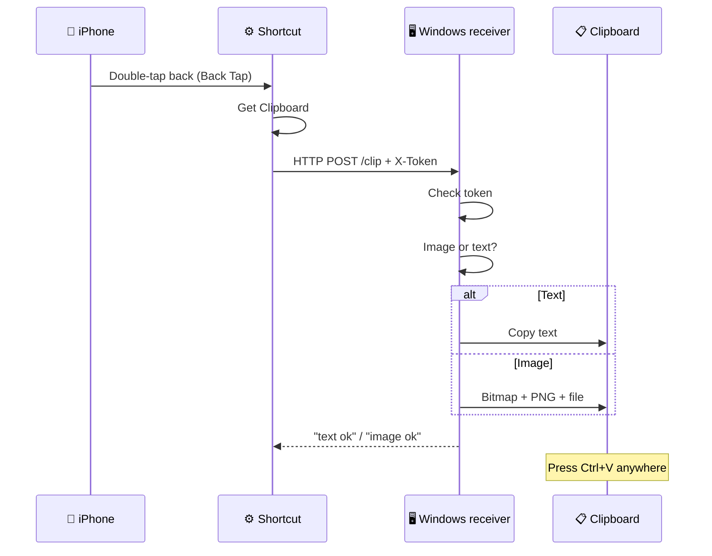

<div align="center">

# 📋 ClipBridge

**Send your iPhone clipboard (text and photos) to Windows with one Back Tap.**

Copy on your iPhone. Double-tap the back. Paste on your PC.

ClipBridge is a tiny background receiver that gives Windows a "Universal Clipboard" for iPhone, built from an iOS Shortcut and about 100 lines of Python.


</div>

---

## ✨ Why this exists

Apple's Universal Clipboard only works between Apple devices. If you have an iPhone and a Windows PC, there's no built-in way to copy something on one and paste it on the other. ClipBridge fills that gap.

iOS doesn't allow apps to watch the clipboard in the background, so a fully automatic sync isn't possible. This project gets as close as the platform allows: **one gesture on the phone, then Ctrl+V on the PC.**

## 🚀 Features

- 📝 **Text and images** from the same shortcut, with no separate setup for each
- 🖼️ **iPhone HEIC photos** are converted automatically
- 🔄 **EXIF orientation fix**, so photos aren't pasted sideways
- 📂 **Pastes everywhere**: Paint, Word, chat apps, browsers and File Explorer
- 👆 **Back Tap trigger**: double-tap the back of the phone, with no app to open
- 🔒 **Shared-secret token**, so random devices on your network can't touch your clipboard
- 🪶 **Practically free to run**: idle CPU use is 0% and memory is a few tens of MB
- 🙈 **Silent background process** with no terminal window, starting automatically with Windows
- 🧹 **Self-cleaning**: saved images older than 7 days are deleted automatically

## 🧠 How it works



1. The **Back Tap** gesture runs an iOS Shortcut.
2. The Shortcut reads your clipboard and sends it over your local network to the PC.
3. A small **Flask** server on the PC checks the secret token and works out whether the payload is an image or text.
4. Text is copied as is. Images are placed on the clipboard in **three formats at once**, so every app can paste them:

| Clipboard format | Used by |
|---|---|
| `CF_DIB` (bitmap) | Paint, Word, chat apps, most editors |
| `PNG` (registered format) | Browsers (Chrome, Edge, Firefox) |
| `CF_HDROP` (file path) | File Explorer and upload boxes that accept pasted files |

## 📦 Requirements

- Windows 10 or 11
- Python 3.8 or newer
- An iPhone with the **Shortcuts** app (iPhone 8 or newer for Back Tap)
- Both devices on the **same Wi-Fi network**

## 🛠️ Setup

### 1. Install

```bash
git clone https://github.com/<your-username>/clipbridge.git
cd clipbridge
pip install -r requirements.txt
```

### 2. Configure

Open `clip_receiver.pyw` in a text editor and set your own secret:

```python
SECRET = "change-this-to-your-own-secret"
```

Use something long and random. **Never commit your real secret to GitHub.**

| Setting | Default | Meaning |
|---|---|---|
| `SECRET` | *(you choose)* | Shared token, must match the `X-Token` header in your Shortcut |
| `PORT` | `5000` | Port the server listens on |
| `SAVE_DIR` | `~/Pictures/iPhone Clipboard` | Where received images are saved as PNG |
| `KEEP_DAYS` | `7` | Saved images older than this are deleted |

### 3. Name your PC

Go to **Settings → System → About** and check **Device name**. It should contain only letters, numbers and hyphens (rename it if not). Your PC is then reachable at:

```
http://<device-name>.local:5000/clip
```

Using the `.local` name instead of an IP address means the setup keeps working when you change Wi-Fi networks.

### 4. Run it

Double-click `clip_receiver.pyw`. Nothing visible happens, because it runs silently in the background.

When Windows Firewall asks, allow access on **Private networks**.

### 5. Build the iPhone Shortcut

Open **Shortcuts → +** and create a shortcut named **Send to PC** with two actions:

1. **Get Clipboard**
2. **Get Contents of URL**, set up as follows:

| Field | Value |
|---|---|
| URL | `http://<device-name>.local:5000/clip` |
| Method | `POST` |
| Headers | `X-Token` = your secret |
| Request Body | `File` → the **Clipboard** variable |

> ⚠️ **iOS likes to capitalize the first letter** of what you type. The path must end in lowercase `/clip`. (The server accepts `/Clip` too, but a lowercase URL is safest.) Don't leave a variable bubble inside the URL field.

Optional: add **Show Notification** at the end to confirm it sent.

The first run will ask permission to access devices on your local network. Tap **Allow**.

### 6. Attach it to Back Tap

**Settings → Accessibility → Touch → Back Tap → Double Tap → Send to PC**

### 7. Use it

Copy text or a photo on the iPhone, double-tap the back of the phone, and press **Ctrl+V** on the PC. ✅

## 🚦 Start automatically with Windows

**Startup folder**

1. Press `Win + R`, type `shell:startup`, press Enter.
2. Right-click `clip_receiver.pyw` → **Show more options → Create shortcut**.
3. Move the shortcut into the Startup folder.

**Task Scheduler (more reliable on stripped-down Windows builds)**

1. Run `where pythonw` in Command Prompt and note the path.
2. Open **Task Scheduler → Create Basic Task**, trigger **When I log on**, action **Start a program**.
3. Program: the `pythonw.exe` path. Arguments: `"C:\path\to\clip_receiver.pyw"`.

Use one method, not both, or the second copy will fail because the port is already in use.

**To stop it:** Task Manager → **Details** tab → end `pythonw.exe`.

## 🔧 Troubleshooting

| Symptom | Likely cause and fix |
|---|---|
| **"Unsupported URL"** in Shortcuts | A variable bubble or missing `http://` in the URL field. Clear the field and type it again |
| **404 Not Found** | Wrong path or capitalization. Use `/clip` |
| **403 Forbidden** | `X-Token` doesn't match `SECRET`. Check for typos and trailing spaces |
| **Timeout or can't connect** | Receiver isn't running, devices are on different networks, or the Wi-Fi profile is set to *Public* in Windows. Set it to **Private** |
| `.local` name not found | Try the PC's IP from `ipconfig` to confirm everything else works. Some Windows debloat builds disable name discovery |
| **Image pastes in Paint but not Explorer or a website** | Make sure you're running the latest `clip_receiver.pyw`, and end any old `pythonw.exe` first |
| **Text pastes, images don't** | Run `pip install pywin32 pillow pillow-heif` again, then restart the receiver |
| **`clipboard busy` (503)** | Another app (often a clipboard manager) is holding the clipboard. Try again |
| **Nothing happens in Notepad when pasting an image** | Notepad can't display images. Paste into Paint, Word or a chat app |

## ⚠️ Limitations

- **Tap-to-send, not automatic.** iOS has no background clipboard access and no "clipboard changed" trigger.
- **Same network required.** Both devices need to be on the same Wi-Fi.
- **Some networks block it.** Hotels, cafés and some offices isolate devices from each other.
- **PC must be awake.** If the laptop sleeps, the receiver sleeps too.
- **One item at a time.** Copying several photos sends only the first.
- **Transparency is flattened** in the bitmap and Paint paste. The saved PNG file keeps it.
- **One direction.** This is iPhone → PC only.

### Need it to work on any network?

Install [**Tailscale**](https://tailscale.com) on both devices (free for personal use), sign in with the same account, and use the PC's Tailscale name or `100.x.y.z` address in the Shortcut URL. It works across different Wi-Fi networks, on mobile data, and on isolated public Wi-Fi, as long as the PC is on and online.

## 🔐 Security

- The server listens on `0.0.0.0` so your phone can reach it. Anyone on the same network who knows the token can overwrite your clipboard.
- The token travels over **plain HTTP**, so use this only on networks you trust, or over Tailscale.
- Use a long, random `SECRET`, and don't reuse a password you care about.
- For extra safety, restrict the Windows Firewall rule to your iPhone's IP address.
- There is no request-size limit. Don't expose this to the internet.

## 🗂️ Project structure

```
clipbridge/
├── clip_receiver.pyw   # the ClipBridge receiver (runs with no console window)
├── requirements.txt    # Python dependencies
└── README.md
```

## 💡 Ideas for later

- [ ] PC → iPhone direction (a Windows clipboard watcher pushing to a notification service)
- [ ] Tray icon with a pause/quit menu
- [ ] HTTPS support
- [ ] Multiple images in a single send

## 📄 License

[MIT](LICENSE). Not affiliated with or endorsed by Apple or Microsoft.
